  
<table>
<tr>
<td valign="top" width="43%"></td>
<td valign="top" width="57%"></td>
</tr>
</table>
 
Inspired by <a href="https://www.avivashishta.com/blog/build-animated-github-profile-readme">Avi Vashishta's animated profile guide</a>.

