<h3><code>karl21-02@github ~ $ ./contributions.sh</code></h3>

  
<h3><code>karl21-02@github ~ $ whoami</code></h3>
<table>
<tr>
<td valign="top" width="43%"></td>
<td valign="top" width="57%"></td>
</tr>
</table>
 
<a href="https://karl21-02.github.io/KarlPage/">Portfolio</a> &nbsp;·&nbsp;
<a href="https://github.com/karl21-02/GraphRAG">GraphRAG</a> &nbsp;·&nbsp;
<a href="https://github.com/karl21-02/boardserver">boardserver</a> &nbsp;·&nbsp;
<a href="https://github.com/karl21-02/Synesth">Synesth</a>
  
Inspired by <a href="https://www.avivashishta.com/blog/build-animated-github-profile-readme">Avi Vashishta's animated profile guide</a>.

